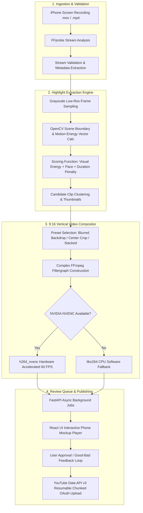

# ⚡ Jovyx Shorts Factory

[](https://github.com/jovyxmc/jovyx-shorts-factory/actions/workflows/ci.yml)
[](https://fastapi.tiangolo.com)
[](https://react.dev/)
[](https://www.typescriptlang.org/)
[](https://opencv.org/)
[](https://developer.nvidia.com/video-encode-decode-gpu-support-matrix)
[](https://www.docker.com/)
[](https://opensource.org/licenses/MIT)

**Production-grade local video automation engine & YouTube Shorts creator that transforms horizontal iPhone eFootball Mobile recordings into high-engagement 9:16 vertical Shorts.**

Built with **FastAPI**, **React + Vite + TypeScript**, **OpenCV**, and **NVIDIA NVENC hardware acceleration** on **Arch Linux**.

---

## 🏗️ Architecture Pipeline



---

## 🎯 Core Features & Engineering Highlights

- **Dynamic Mobile Gameplay Vertical Layouts:**
  - **Gaussian Blurred Backdrop (Recommended):** Centers 16:9 mobile gameplay in a vertical 9:16 frame surrounded by blurred, dynamic gameplay. Radar, scoreboards, and virtual controls stay crisp.
  - **Center Action Crop:** Crops a focused 9:16 slice following center-pitch action.
  - **Dual Stacked View:** Wide strategic tactical overview on top with zoomed action on bottom.
- **Hardware Acceleration with Zero-Config Fallback:**
  - Automatically activates NVIDIA NVENC (`h264_nvenc`) on NVIDIA GPUs for ultra-fast 1080x1920 @ 60 FPS encoding.
  - Graceful fallback to `libx264` software encoding when running in headless CPU containers or machines without proprietary drivers.
- **Computer Vision Highlight Detection:**
  - Fast visual scene change and motion-energy clustering using OpenCV.
  - Candidate clip extraction with configurable clip durations (15s–60s).
  - Thumbnail generation with energy-ranked scoring.
  - Interactive feedback loop: Users can rate clips 👍 / 👎 to reinforce clip prioritization.
- **Async Job Queue & Non-Blocking API:**
  - Database-backed job queue running on SQLite with `aiosqlite` and Async SQLAlchemy.
  - Real-time job progress tracking and cancellation support.
- **YouTube Data API v3 OAuth Publishing:**
  - Official OAuth 2.0 flow with local token storage in SQLite.
  - Resumable chunked uploads with exponential backoff on transient network failures.
  - Safe by default: uploads start strictly as private drafts.
- **Full-Stack Single-Unit Containerization:**
  - Multi-stage Docker build packaging the Node/Vite frontend into a minimal Debian Python 3.12 runtime with FFmpeg and fonts included.

---

## 💻 System Requirements

- **OS:** Linux (Arch Linux, Ubuntu, Debian, Fedora), macOS, or Windows (WSL2 / Docker)
- **Runtime:** Python 3.11+ and Node.js 20+
- **Video Tools:** FFmpeg with `ffprobe` installed
- **Optional GPU:** NVIDIA GeForce / RTX GPU with proprietary NVIDIA drivers (`nvidia`, `nvidia-utils`)

---

## 🚀 Getting Started

### Option A: Local Development (Recommended for Arch Linux)

```bash
# 1. Clone the repository
git clone https://github.com/jovyxmc/jovyx-shorts-factory.git
cd jovyx-shorts-factory

# 2. Copy environment configuration
cp .env.example .env

# 3. Start development servers (Vite hot-reloading + FastAPI backend)
make dev
# Or run manually: ./run.sh --dev
```

- **Frontend:** [http://localhost:5173](http://localhost:5173)
- **Backend API Docs:** [http://localhost:8000/docs](http://localhost:8000/docs)

### Option B: Production Server Run

```bash
./run.sh
```
Automatically compiles the frontend bundle if missing and starts the unified server at [http://localhost:8000](http://localhost:8000).

### Option C: Docker & Docker Compose

Run anywhere without needing local Python or Node setups:

```bash
# Build and launch in background
docker compose up -d

# Check service health and logs
docker compose logs -f
```
Open [http://localhost:8000](http://localhost:8000).

---

## 🧪 Testing

The test suite validates probe metadata extraction, complex FFmpeg filtergraph construction, highlight scoring, and end-to-end API workflows.

```bash
make test
# Or: backend/.venv/bin/pytest -v
```

```
============================== 16 passed in 2.59s ==============================
```

---

## 📁 Directory Structure

```
jovyx-shorts-factory/
├── run.sh                  # One-click startup script (production / dev mode)
├── Makefile                # Developer build, test, and container shortcuts
├── Dockerfile              # Multi-stage production container build
├── docker-compose.yml      # Container orchestration with volume mounts
├── pytest.ini              # Pytest configuration
├── backend/
│   ├── requirements.txt    # Python dependencies
│   ├── storage/            # Managed storage (originals, thumbnails, renders, exports)
│   └── app/
│       ├── main.py         # FastAPI application entrypoint & static mounting
│       ├── config.py       # Pydantic Settings configuration
│       ├── database/       # SQLite + Async SQLAlchemy ORM models
│       ├── video/          # FFprobe metadata, NVENC detection, rendering engine
│       ├── highlights/     # OpenCV scene detection, scoring, candidate clustering
│       ├── publishing/     # YouTube OAuth 2.0 & resumable upload service
│       ├── services/       # Background jobs, presets, AI metadata
│       └── api/            # REST API route controllers
└── frontend/
    ├── src/
    │   ├── api/            # Typed API client
    │   ├── types/          # TypeScript interfaces
    │   ├── components/     # UI components (Mockup, Player, Navigation)
    │   └── pages/          # Dashboard, Highlights, Review Queue, Settings
    ├── package.json
    └── vite.config.ts
```

---

## 🔒 Security & Reliability Guarantees

1. **Subprocess Sanitization:** All FFmpeg and FFprobe calls execute using explicit argument lists without `shell=True`, preventing shell injection vulnerabilities.
2. **Path Traversal Protection:** User-supplied paths are validated for existence, regular file status, and extension whitelisting (`.mov`, `.mp4`, `.m4v`, `.mkv`, `.webm`).
3. **Source Video Immutability:** Original gameplay recordings are never overwritten or deleted.
4. **Memory & VRAM Safety:** Motion analysis operates on downscaled 160x90 grayscale frames, leaving system RAM and GPU VRAM unburdened.
5. **Private YouTube Uploads:** Uploads default to `private` privacy status and require explicit user review and approval before publishing.

---

## 📄 License
This project is licensed under the MIT License - see the [LICENSE](LICENSE) file for details.
